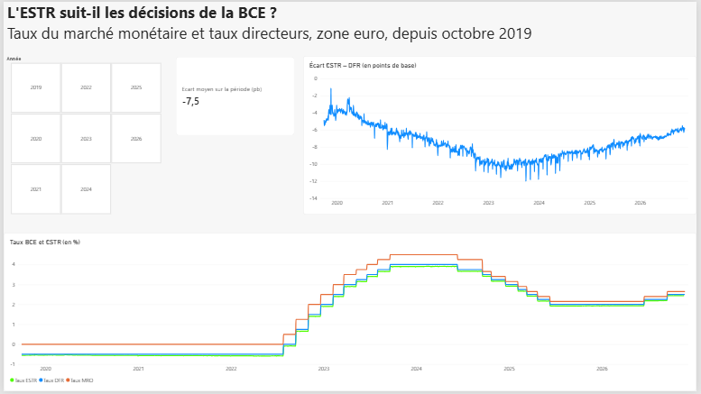

# Tableau de bord des taux BCE

## Avancement

- [x] Cadrage du projet (question métier, utilisateurs, sources, indicateurs, périmètre)
- [x] Collecte des données brutes (API BCE)
- [x] Préparation des données (Power Query)
- [x] Modélisation et indicateurs (Power BI, DAX)
- [x] Tableau de bord et analyse des résultats

## Aperçu

## Résultats

1. **Une transmission immédiate.** Le 14 septembre 2022, date d'entrée en vigueur de la hausse du DFR (de 0 % à 0,75 %), l'€STR passe de −0,083 % à 0,662 % le jour même.
2. **Un écart persistant sous le taux plancher.** Sur la période (octobre 2019 – novembre 2026), l'€STR se situe en moyenne **7,5 points de base** sous le DFR.
3. **Un écart qui se creuse, puis se resserre.**

| Année | 2019* | 2020 | 2021 | 2022 | 2023 | 2024 | 2025 | 2026* |
|---|---|---|---|---|---|---|---|---|
| Écart moyen (pb) | −4,2 | −4,7 | −6,8 | −8,6 | **−10,0** | −8,9 | −7,8 | −6,6 |

*Années partielles.* L'explication généralement avancée est le niveau d'excès de liquidité : abondante après les injections de la BCE (2020-2022), puis en réduction depuis 2023.

4. **Des effets de fin de période.** Les écarts les plus marqués tombent sur les derniers jours ouvrés de mois et de trimestre (par exemple −12,0 pb le 29 septembre 2023 et −11,8 pb le 29 décembre 2023).

**Méthode** : l'écart est calculé comme la moyenne des écarts quotidiens, sur les seuls jours de publication de l'€STR (mesure DAX `AVERAGEX`). Les résultats ont été vérifiés par un recalcul indépendant à partir des fichiers bruts.

**Limites** : mise à jour manuelle des données ; l'explication par la liquidité est une hypothèse, non testée dans ce projet (elle nécessiterait les données d'excès de liquidité de la BCE).
## 1. Question métier

Le taux du marché monétaire en euro (€STR) suit-il fidèlement les décisions de taux de la BCE, et quel écart persiste entre les deux ?

## 2. Utilisateurs

- **Trésorerie** : suivre le coût réel de la liquidité au jour le jour et anticiper l'effet des décisions de la BCE.
- **Gestion actif-passif (ALM)** : alimenter les scénarios d'évolution des taux qui pèsent sur la marge de la banque.
- **Desk de taux (salle des marchés)** : disposer d'un historique fiable de l'€STR, taux de référence de nombreux produits dérivés.

## 3. Sources

Données publiques issues de l'API du portail de données de la BCE (ECB Data Portal), téléchargées au format CSV.

| Série | Clé BCE | Fréquence | Fichier |
|---|---|---|---|
| €STR (taux du marché monétaire au jour le jour) | `EST.B.EU000A2X2A25.WT` | Jours ouvrés (B) | `data/raw/bce_estr_quotidien.csv` |
| Taux de la facilité de dépôt (DFR) | `FM.D.U2.EUR.4F.KR.DFR.LEV` | Quotidienne (D) | `data/raw/bce_dfr_quotidien.csv` |
| Taux des opérations principales de refinancement (MRO) | `FM.D.U2.EUR.4F.KR.MRR_RT.LEV` | Quotidienne (D) | `data/raw/bce_mro_quotidien.csv` |

**Choix de la série MRO** : la série `MRR_RT` a été retenue car elle couvre en continu les deux modes d'adjudication de la BCE (taux minimum de soumission avant 2008, taux fixe depuis), contrairement à `MRR_FR`.

**Point d'attention** : l'€STR n'est publié que les jours ouvrés, alors que le DFR et le MRO sont quotidiens. Les séries seront alignées lors de la préparation des données.

## 4. Indicateurs

| Indicateur | Calcul | Ce qu'il montre |
|---|---|---|
| Niveau des taux | Valeur quotidienne de l'€STR, du DFR et du MRO (en %) | L'évolution de la politique monétaire depuis 2019 |
| Écart €STR – DFR | (€STR − DFR) × 100, en points de base | Si le marché se situe au-dessus ou en dessous du taux plancher de la BCE |
| Écart moyen par période | Moyenne de l'écart €STR – DFR par mois et par année | Si l'écart est stable ou s'il évolue dans le temps |
| Réaction aux décisions | Variation de l'€STR autour de chaque date de changement du DFR | La vitesse et l'ampleur de la transmission des décisions au marché |

*1 point de base (pb) = 0,01 point de pourcentage.*

## 5. Périmètre

**Inclus**
- Zone euro, à partir d'octobre 2019 (date de première publication de l'€STR)
- Trois séries : €STR, taux de la facilité de dépôt (DFR), taux des opérations principales de refinancement (MRO)
- Données quotidiennes, mises à jour manuellement depuis l'API de la BCE

**Exclu**
- Autres taux de marché (Euribor, taux longs, courbe des taux)
- Autres banques centrales (Fed, Banque d'Angleterre…)
- Prévisions d'évolution des taux
- Automatisation de la mise à jour des données (prévue dans un projet ultérieur)